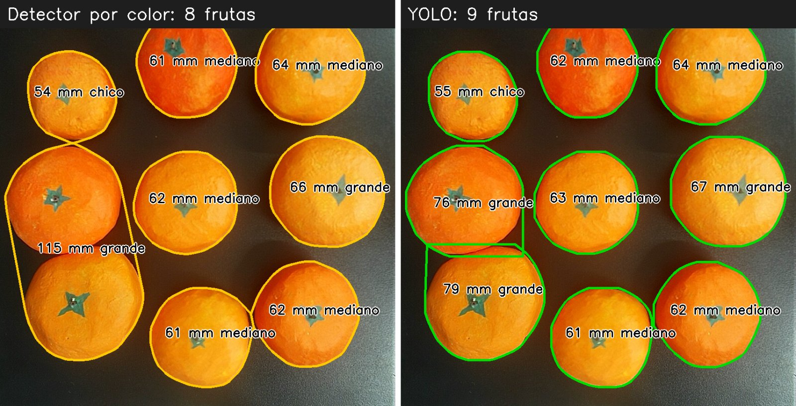
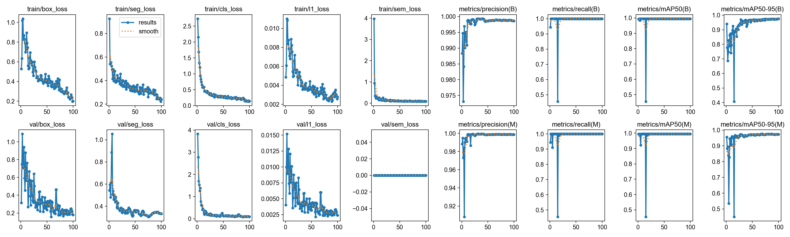
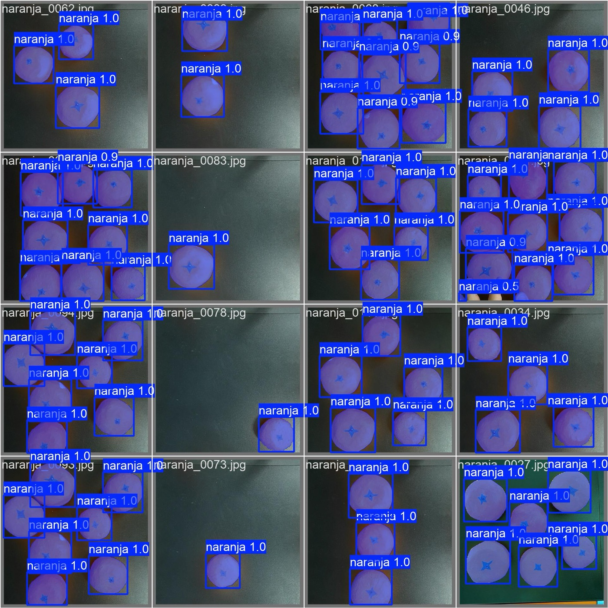
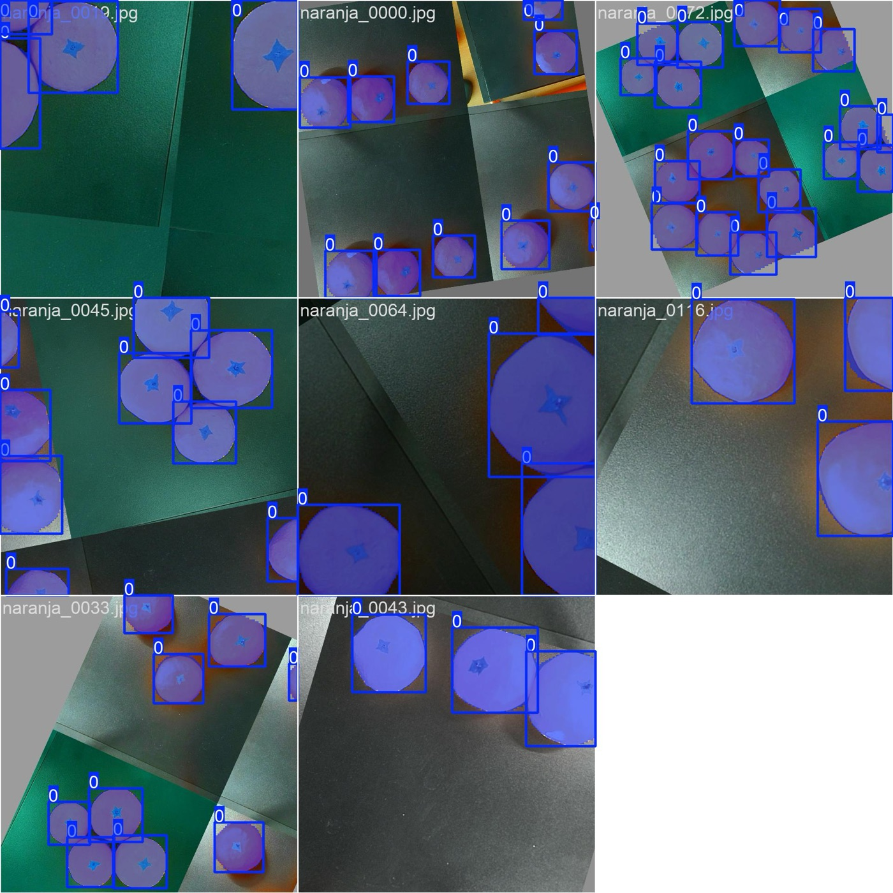
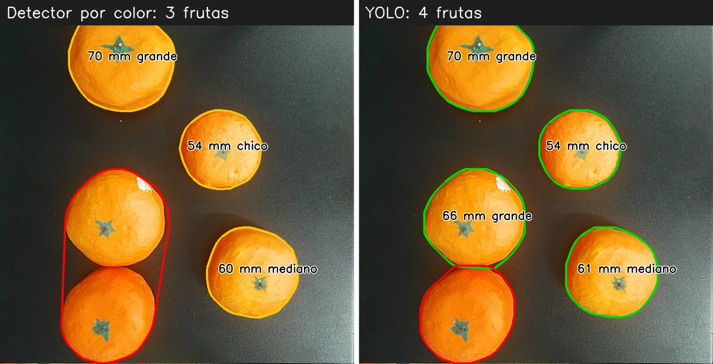

# 🍊 Estación 3: Calibre, uniformidad y consistencia

Módulo de análisis físico del lote de naranjas del proyecto **PackIA Coquimbo**. Evalúa si la caja presenta **coherencia física** para su clasificación comercial.

**Equipo:** Johann Cortés Farías · Martín Zepeda Puelles · Diego Cortés Toro
**Asignaturas:** Taller Integrador II + Inteligencia Artificial, Universidad Central (sede Coquimbo)



## 📋 Resumen de la estación

| Estación | Grupo | Función principal | Enfoque de IA |
|---|---|---|---|
| **3. Calibre, uniformidad y consistencia** | 3 estudiantes | Evaluar tamaño, llenado, peso y coherencia física | Visión computacional + modelo YOLO entrenado por el equipo |

**Problema de IA:** determinar si el lote es consistente en cuanto a tamaño, llenado, peso y coherencia general.

**Salida esperada:** clasificar el lote como `consistente`, `irregular`, `subllenado`, `peso inconsistente` o `revisión`, y entregar la evaluación de consistencia a la **Estación 4**.

---

## 🚦 Estado de avance

| # | Actividad | Estado | Notas |
|---|---|---|---|
| 1 | Diseñar el módulo de análisis físico del lote | 🔄 En proceso | Detección, medición y calibre por fruta funcionando (Fase 0) y modelo YOLO entrenado (Fase 2) |
| 2 | Registrar el peso real, simulado o medido (balanza o cámara) | ⏳ Pendiente | Aún no hay lectura ni simulación de peso |
| 3 | Capturar una imagen de la caja (desde arriba) | ✅ Terminada | Webcam LINK ON fija a 35 cm sobre la superficie negra; tecla `s` guarda fotos |
| 4 | Definir variables (peso, llenado, nº de frutas, uniformidad, coherencia imagen/peso) | 🔄 En proceso | Ya se mide el **diámetro en mm** y se **cuentan las frutas**; faltan peso, llenado y uniformidad |
| 5 | Construir tabla de datos con variables físicas e indicadores visuales | ⏳ Pendiente | Hoy los resultados se muestran en pantalla y en la terminal (tecla `m`) |
| 6 | Clasificar el lote (consistente / irregular / subllenado / peso inconsistente / revisión) | 🔄 En proceso | Por ahora se clasifica **cada fruta** en chico / mediano / grande |
| 7 | Entregar evaluación de consistencia a la Estación 4 | ⏳ Pendiente | Se enviará por red (MQTT) desde una Raspberry Pi |

### Avances técnicos logrados

| Componente | Estado |
|---|---|
| Detección de naranjas por color (HSV) dentro de la zona de trabajo | ✅ Terminada |
| Tolerancia a reflejos de luz (zonas pálidas unidas a la fruta) y relleno del pedúnculo | ✅ Terminada |
| Separación de frutas que se tocan (transformada de distancia) | ✅ Terminada |
| Filtro por forma (circularidad) para descartar falsos positivos | ✅ Terminada |
| Calibración px → mm con la naranja de referencia mediana (tecla `c`) | ✅ Terminada |
| Corrección de perspectiva (bordes de la imagen) y de altura de la fruta | ✅ Terminada |
| Clasificación por calibre (chico / mediano / grande) con **error promedio de 0,8 mm** | ✅ Terminada |
| Dataset propio: **117 fotos** con etiquetado automático | ✅ Terminada |
| Entrenamiento de un modelo **YOLO26n-seg** propio (Fase 2) | ✅ Terminada |
| Comparación detector por color vs YOLO | ✅ Terminada |
| Ejecución en Raspberry Pi y envío de datos por MQTT | ⏳ Pendiente |
| Clasificación por peso mediante balanza | ⚠️ Posiblemente descartada |

> **Leyenda:** ✅ Terminada · 🔄 En proceso · ⏳ Pendiente · ⚠️ Posiblemente descartada

---

## ⚙️ Cómo funciona

El programa repite 5 pasos con cada imagen de la cámara: **mirar → encontrar → medir → clasificar → mostrar**.

1. **Mirar.** La webcam apunta hacia abajo a 35 cm de la superficie negra (simula la cinta transportadora). Solo se analiza la **zona de trabajo** (tecla `z`).
2. **Encontrar** cada naranja, con uno de dos detectores (`USAR_YOLO` en el código):
   - **Por color (HSV):** marca los píxeles de tono naranjo; acepta zonas pálidas por reflejo solo si están unidas a naranjo fuerte, rellena el pedúnculo y separa frutas que se tocan buscando el centro de cada una.
   - **Con IA (YOLO):** un modelo entrenado por el equipo con sus propias fotos entrega el contorno de cada fruta.
3. **Medir.** Al contorno se le ajusta una elipse y se toma su eje mayor. Se convierte a mm con la calibración (≈ 0,29 mm/px) y se corrige la **perspectiva** (frutas en el borde) y la **altura** de la fruta (su parte superior está más cerca de la cámara).
4. **Clasificar** según el diámetro:

   | Calibre | Diámetro |
   |---|---|
   | Chico | menos de 58,5 mm |
   | Mediano | 58,5 a 65 mm |
   | Grande | 65 mm o más |

5. **Mostrar** en pantalla el contorno, la medida y el calibre de cada fruta.

La IA se usa para **encontrar** la fruta y la geometría para **medirla**: así la medida sigue siendo precisa, explicable y basta recalibrar si se mueve la cámara.

---

## 📏 Resultados de medición (Fase 0)

Frutas de referencia medidas a mano con pie de metro:

| Fruta | Real | Programa | Error |
|---|---|---|---|
| Grande | 68 mm | 67,9 mm | −0,1 mm |
| Mediana | 62 mm | 61,1 mm | −0,9 mm |
| Chica | 55 mm | 53,9 mm | −1,1 mm |

- **Error promedio: 0,8 mm.** Las tres frutas quedan siempre en su categoría correcta.
- Variación entre fotos de una misma escena: 0,1 mm. Variación entre calibraciones: 0,4 %.

---

## 🤖 Entrenamiento de YOLO (Fase 2)

### Dataset

- **117 fotos** tomadas con la misma webcam, variando cantidad de frutas (1 a 9), posición, frutas que se tocan, frutas acostadas y en los bordes.
- **Etiquetado automático:** [`generar_dataset.py`](generar_dataset.py) usa el detector por color para dibujar el contorno de cada naranja y lo guarda en formato YOLO. Luego el equipo **revisa** cada foto y descarta las mal etiquetadas.
- Las fotos casi iguales se agrupan en "escenas" para que entrenamiento y validación nunca tengan fotos repetidas: **96 fotos de entrenamiento** y **21 de validación** (90 naranjas).


### Configuración

| Parámetro | Valor |
|---|---|
| Modelo base | `yolo26n-seg.pt` (nano, segmentación; pensado para equipos pequeños como Raspberry Pi) |
| Clases | 1 (`naranja`) |
| Épocas | 100 |
| Tamaño de imagen | 640 px |
| Aumento de datos | giros de hasta 180°, volteo vertical y horizontal, cambios de brillo |
| Equipo | MacBook (Apple A18 Pro, GPU `mps`), 5,1 horas |

### Curvas de entrenamiento

Las pérdidas (`loss`) bajan y las métricas de validación suben hasta estabilizarse cerca de 1:



### Métricas en validación

| Métrica | Caja | Máscara | Qué significa |
|---|---|---|---|
| Precisión (P) | 0,999 | 0,999 | Casi nunca marca algo que no es naranja |
| Recall (R) | 1,000 | 1,000 | Encontró las 90 naranjas de validación |
| mAP50 | 0,995 | 0,995 | Detección prácticamente perfecta |
| mAP50-95 | 0,974 | 0,974 | Los contornos calzan con la fruta incluso exigiendo mucha superposición |

<details>
<summary>Curva precisión-recall de las máscaras</summary>


</details>

### Etiquetas vs predicciones del modelo

| Etiquetas (lo que debía encontrar) | Predicción de YOLO |
|---|---|
|  |  |

<details>
<summary>Lote de entrenamiento con aumento de datos</summary>



</details>

---

## ⚖️ Detector por color vs YOLO

[`comparar_yolo.py`](comparar_yolo.py) pasa las 117 fotos por ambos detectores y compara fruta por fruta ([resultado completo](resultados/comparacion_color_vs_yolo.txt)):

| Indicador | Resultado |
|---|---|
| Frutas completas detectadas | Color: 423 · YOLO: 426 |
| Diferencia promedio en la medida (YOLO − color) | +0,76 mm |
| Diferencia absoluta promedio | 1,06 mm |
| Misma categoría de calibre | 411 de 423 (97 %) |

La principal ventaja de YOLO aparece con **frutas que se tocan**: el detector por color las une en una sola figura, mientras YOLO las separa.



> **Limitaciones actuales:** las etiquetas salen del detector por color, por lo que YOLO aprende también sus límites; y parte de las 117 fotos se usaron para entrenar. Las próximas fotos deben incluir más casos difíciles (frutas pegadas, reflejos fuertes) y la medida de frutas pegadas todavía debe ajustarse.

---

## 📁 Estructura del repositorio

| Archivo | Para qué sirve |
|---|---|
| [`clasificador_naranjas.py`](clasificador_naranjas.py) | Programa principal: cámara, detección, medición y calibre |
| [`configuracion.json`](configuracion.json) | Calibración (mm/px) y zona de trabajo guardadas |
| [`best.pt`](best.pt) | Modelo YOLO entrenado por el equipo |
| [`generar_dataset.py`](generar_dataset.py) | Crea el dataset etiquetado a partir de `fotos/` |
| [`entrenar_yolo_local.py`](entrenar_yolo_local.py) | Entrena YOLO en el computador (GPU de Mac) |
| [`entrenar_yolo_naranjas.ipynb`](entrenar_yolo_naranjas.ipynb) | Alternativa: entrenar en Google Colab con GPU |
| [`comparar_yolo.py`](comparar_yolo.py) | Compara el detector por color con YOLO |
| [`resultados/`](resultados) | Métricas por época, configuración del entrenamiento y comparación |
| [`docs/img/`](docs/img) | Imágenes del README |

Las fotos (`fotos/`) y el dataset generado no se suben al repositorio por su tamaño.

---

## ▶️ Cómo ejecutarlo

### Instalación (una vez)

```bash
python3 -m venv venv
source venv/bin/activate
pip install -r requirements.txt
```

### Uso diario

```bash
source venv/bin/activate
python3 clasificador_naranjas.py
```

| Tecla | Acción |
|---|---|
| `c` | Calibrar: dejar **solo la naranja mediana de 62 mm** en la zona |
| `z` | Cambiar la zona de trabajo (arrastrar rectángulo y Enter) |
| `m` | Mostrar en la terminal las medidas de todas las frutas |
| `s` | Guardar la foto actual en `fotos/` (para el dataset) |
| `q` | Salir |

Para usar el detector YOLO, cambiar en [`clasificador_naranjas.py`](clasificador_naranjas.py):

```python
USAR_YOLO = True
```

### Ciclo para mejorar el modelo

```bash
python3 clasificador_naranjas.py   # sacar fotos variadas con la tecla s
python3 generar_dataset.py         # etiquetar automáticamente
# revisar dataset_naranjas/revision y borrar de fotos/ las mal etiquetadas
python3 entrenar_yolo_local.py     # entrenar (deja el modelo nuevo en best.pt)
python3 comparar_yolo.py           # comparar resultados
```

---

## 🛠️ Tecnologías utilizadas

| Tecnología | Uso |
|---|---|
| **Python** | Lenguaje principal |
| **OpenCV** | Captura de video, segmentación por color, medición |
| **NumPy** | Manejo de matrices e imágenes |
| **Ultralytics YOLO26** + **PyTorch** | Entrenamiento y uso del modelo de segmentación |
| **Webcam LINK ON (USB)** | Captura fija a 35 cm sobre la superficie |

---

## 🔭 Próximos pasos

- [ ] Más fotos con casos difíciles y reentrenar YOLO.
- [ ] Llevar el sistema a una **Raspberry Pi** (modelo exportado a NCNN).
- [ ] Enviar cada medida por **MQTT** a la estación de separación y a un dashboard.
- [ ] Registrar el peso del lote (balanza, cámara o simulado).
- [ ] Calcular uniformidad de tamaño y nivel de llenado de la caja.
- [ ] Generar la tabla de datos (CSV) con las variables físicas.
- [ ] Clasificar el lote completo (consistente, irregular, subllenado, peso inconsistente, revisión).
- [ ] Enviar la evaluación a la Estación 4.
