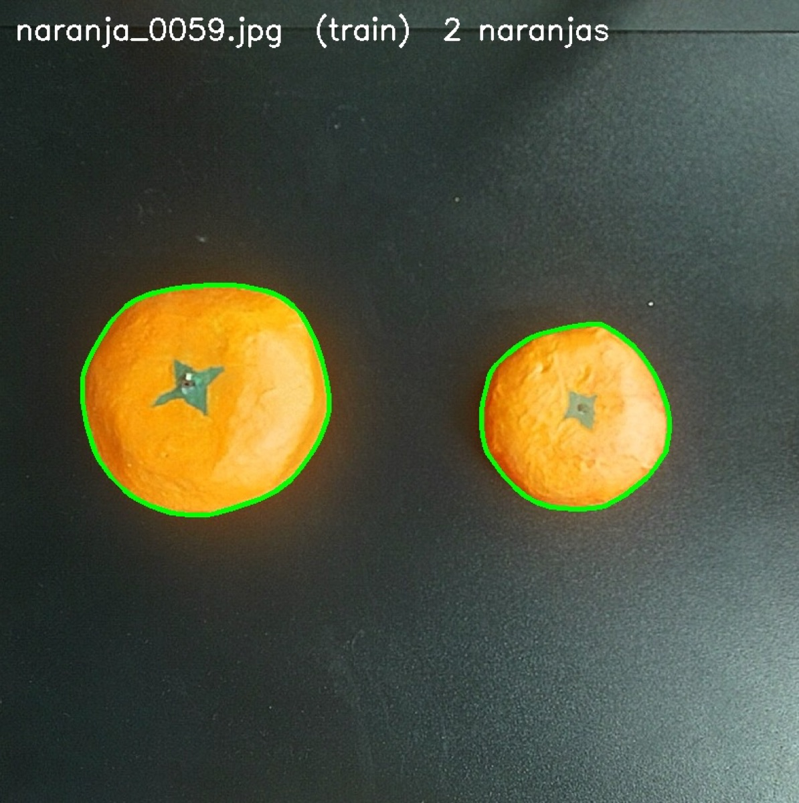
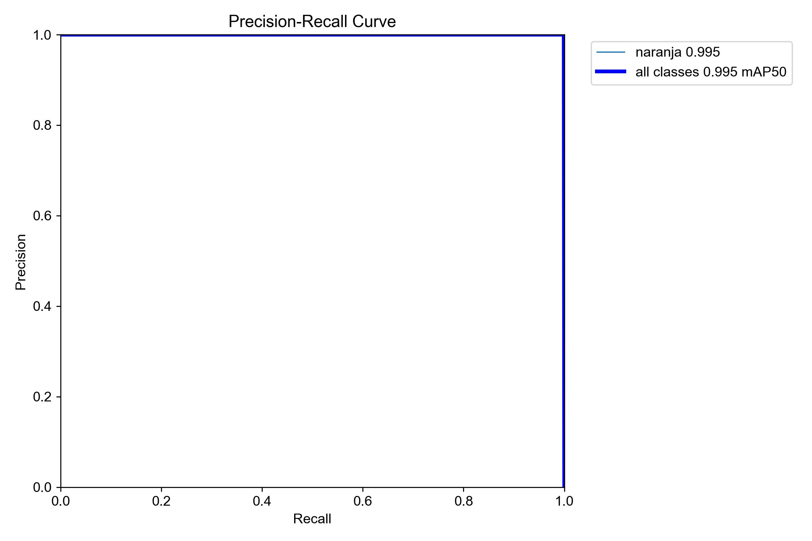
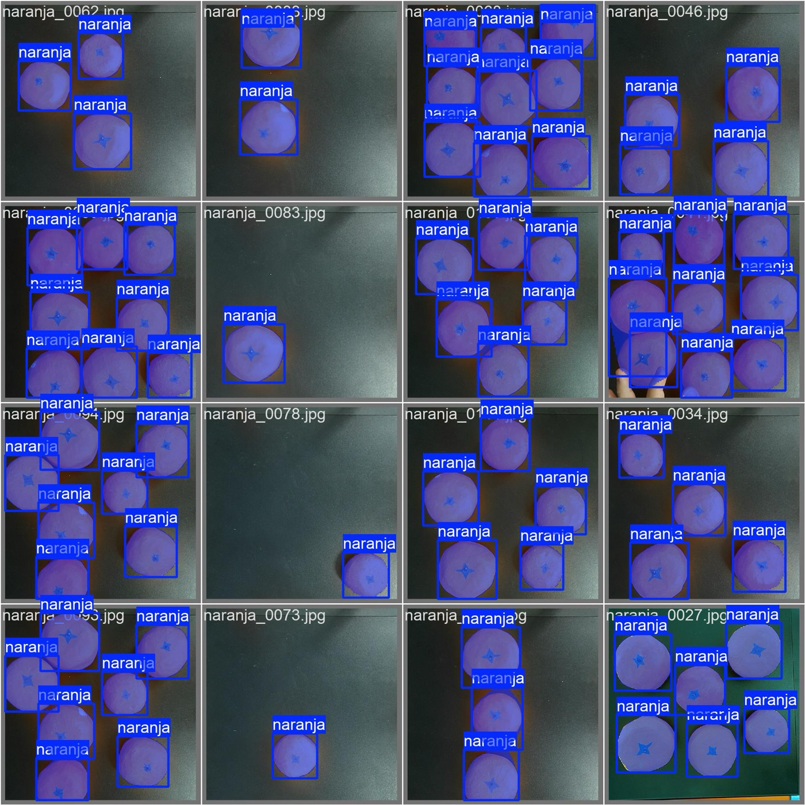

# 🍊 Estación 3: Calibre, uniformidad y consistencia

Módulo de análisis físico del lote de naranjas del proyecto **PackIA Coquimbo**. Evalúa si la caja presenta **coherencia física** para su clasificación comercial.

**Equipo:** Johann Cortés Farías · Martín Zepeda Puelles · Diego Cortés Toro
**Asignaturas:** Taller Integrador II + Inteligencia Artificial, Universidad Central (sede Coquimbo)


## 📋 Resumen de la estación

| Estación | Grupo | Función principal | Enfoque de IA |
|---|---|---|---|
| **3. Calibre** | 3 estudiantes | Medir el diámetro de cada naranja que pasa en fila por la cinta y clasificarla por calibre | Visión computacional + modelo YOLO entrenado por el equipo |

**Problema de IA:** encontrar cada naranja en la imagen de la cinta y medir su diámetro con precisión de milímetros.

**Salida:** para cada naranja, su calibre (`chico`, `mediano`, `grande` o `revision`), enviado **de inmediato por HTTP** a:
- **Estación 4:** separa la naranja con un servomotor según su calibre.
- **Estación 5:** dashboard con el total de frutas y cuántas hay de cada calibre.

> El alcance se ajustó: se clasifica **fruta por fruta** en la cinta (ya no el lote completo ni el peso).

---

## 🚦 Estado de avance

| # | Actividad | Estado | Notas |
|---|---|---|---|
| 0 | Medir y clasificar cada fruta por calibre | ✅ Terminada | Error promedio de 0,8 mm |
| 1 | Dataset propio de fotos | ✅ Terminada | 117 fotos, etiquetado automático |
| 2 | Entrenar un modelo YOLO propio | ✅ Terminada | Encuentra las 90 naranjas de validación (mAP50-95 = 0,974) |
| 3 | Modo cinta: seguir cada fruta en la fila y decidir al cruzar una línea | ✅ Terminada (probado con video simulado) | Falta probar con la cinta real |
| 4 | Envío por HTTP a las estaciones 4 y 5 | ✅ Terminada (probado con simulador) | Faltan las IP reales del router |
| 5 | Autocalibración con marcador impreso | ✅ Terminada (probado con video simulado) | Error de 0,1 % en la escala |
| 6 | Llevar el sistema a la Raspberry Pi | ⏳ Pendiente | Guía en [docs/raspberry_pi.md](docs/raspberry_pi.md) |
| 7 | Prueba de punta a punta con las estaciones 4 y 5 | ⏳ Pendiente | |

### Avances técnicos logrados

| Componente | Estado |
|---|---|
| Detección de naranjas por color (HSV) dentro de la zona de trabajo | ✅ Terminada |
| Tolerancia a reflejos de luz (zonas pálidas unidas a la fruta) y relleno del pedúnculo | ✅ Terminada |
| Separación de frutas que se tocan (transformada de distancia) | ✅ Terminada |
| Filtro por forma (circularidad) para descartar falsos positivos | ✅ Terminada |
| Calibración px → mm con la naranja de referencia mediana (tecla `c`) | ✅ Terminada |
| Corrección de perspectiva (bordes de la imagen) y de altura de la fruta | ✅ Terminada |
| Clasificación por calibre (chico / mediano / grande) con **error promedio de 0,8 mm** | ✅ Terminada |
| Dataset propio: **117 fotos** con etiquetado automático | ✅ Terminada |
| Entrenamiento de un modelo **YOLO26n-seg** propio (Fase 2) | ✅ Terminada |
| Comparación detector por color vs YOLO | ✅ Terminada |
| Seguimiento de cada fruta en la cinta y decisión en la línea | ✅ Terminada |
| Envío del calibre por HTTP (JSON) a las estaciones 4 y 5 | ✅ Terminada |
| Autocalibración con marcador ArUco | ✅ Terminada |
| Modelo YOLO exportado a NCNN para Raspberry Pi | ✅ Terminada |
| Ejecución en Raspberry Pi | ⏳ Pendiente |
| Clasificación por peso y del lote completo | ❌ Descartada (cambio de alcance) |

> **Leyenda:** ✅ Terminada · 🔄 En proceso · ⏳ Pendiente · ❌ Descartada

---

## ⚙️ Cómo funciona

El programa repite 5 pasos con cada imagen de la cámara: **mirar → encontrar → medir → clasificar → mostrar**.

1. **Mirar.** La webcam apunta hacia abajo a 35 cm de la superficie negra (simula la cinta transportadora). Solo se analiza la **zona de trabajo** (tecla `z`).
2. **Encontrar** cada naranja, con uno de dos detectores (`USAR_YOLO` en el código):
   - **Por color (HSV):** marca los píxeles de tono naranjo; acepta zonas pálidas por reflejo solo si están unidas a naranjo fuerte, rellena el pedúnculo y separa frutas que se tocan buscando el centro de cada una.
   - **Con IA (YOLO):** un modelo entrenado por el equipo con sus propias fotos entrega el contorno de cada fruta.
3. **Medir.** Al contorno se le ajusta una elipse y se toma su eje mayor. Se convierte a mm con la calibración (≈ 0,29 mm/px) y se corrige la **perspectiva** (frutas en el borde) y la **altura** de la fruta (su parte superior está más cerca de la cámara).
4. **Clasificar** según el diámetro:

   | Calibre | Diámetro |
   |---|---|
   | Chico | menos de 58,5 mm |
   | Mediano | 58,5 a 65 mm |
   | Grande | 65 mm o más |

5. **Mostrar** en pantalla el contorno, la medida y el calibre de cada fruta.

La IA se usa para **encontrar** la fruta y la geometría para **medirla**: así la medida sigue siendo precisa, explicable y basta recalibrar si se mueve la cámara.

---

## 📏 Resultados de medición (Fase 0)

Frutas de referencia medidas a mano con pie de metro:

| Fruta | Real | Programa | Error |
|---|---|---|---|
| Grande | 68 mm | 67,9 mm | −0,1 mm |
| Mediana | 62 mm | 61,1 mm | −0,9 mm |
| Chica | 55 mm | 53,9 mm | −1,1 mm |

- **Error promedio: 0,8 mm.** Las tres frutas quedan siempre en su categoría correcta.
- Variación entre fotos de una misma escena: 0,1 mm. Variación entre calibraciones: 0,4 %.

---

## 🤖 Entrenamiento de YOLO (Fase 2)

### Dataset

- **117 fotos** tomadas con la misma webcam, variando cantidad de frutas (1 a 9), posición, frutas que se tocan, frutas acostadas y en los bordes.
- **Etiquetado automático:** [`generar_dataset.py`](generar_dataset.py) usa el detector por color para dibujar el contorno de cada naranja y lo guarda en formato YOLO. Luego el equipo **revisa** cada foto y descarta las mal etiquetadas.
- Las fotos casi iguales se agrupan en "escenas" para que entrenamiento y validación nunca tengan fotos repetidas: **96 fotos de entrenamiento** y **21 de validación** (90 naranjas).



### Configuración

| Parámetro | Valor |
|---|---|
| Modelo base | `yolo26n-seg.pt` (nano, segmentación; pensado para equipos pequeños como Raspberry Pi) |
| Clases | 1 (`naranja`) |
| Épocas | 100 |
| Tamaño de imagen | 640 px |
| Aumento de datos | giros de hasta 180°, volteo vertical y horizontal, cambios de brillo |
| Equipo | MacBook (Apple A18 Pro, GPU `mps`), 5,1 horas |

### Curvas de entrenamiento

Las pérdidas (`loss`) bajan y las métricas de validación suben hasta estabilizarse cerca de 1:


### Métricas en validación

| Métrica | Caja | Máscara | Qué significa |
|---|---|---|---|
| Precisión (P) | 0,999 | 0,999 | Casi nunca marca algo que no es naranja |
| Recall (R) | 1,000 | 1,000 | Encontró las 90 naranjas de validación |
| mAP50 | 0,995 | 0,995 | Detección prácticamente perfecta |
| mAP50-95 | 0,974 | 0,974 | Los contornos calzan con la fruta incluso exigiendo mucha superposición |

<details>
<summary>Curva precisión-recall de las máscaras</summary>



</details>

### Etiquetas vs predicciones del modelo

| Etiquetas (lo que debía encontrar) | Predicción de YOLO |
|---|---|
|  |  |

<details>
<summary>Lote de entrenamiento con aumento de datos</summary>


</details>

---

## ⚖️ Detector por color vs YOLO

[`comparar_yolo.py`](comparar_yolo.py) pasa las 117 fotos por ambos detectores y compara fruta por fruta ([resultado completo](resultados/comparacion_color_vs_yolo.txt)):

| Indicador | Resultado |
|---|---|
| Frutas completas detectadas | Color: 423 · YOLO: 426 |
| Diferencia promedio en la medida (YOLO − color) | +0,76 mm |
| Diferencia absoluta promedio | 1,06 mm |
| Misma categoría de calibre | 411 de 423 (97 %) |

La principal ventaja de YOLO aparece con **frutas que se tocan**: el detector por color las une en una sola figura, mientras YOLO las separa.


> **Limitaciones actuales:** las etiquetas salen del detector por color, por lo que YOLO aprende también sus límites; y parte de las 117 fotos se usaron para entrenar. Las próximas fotos deben incluir más casos difíciles (frutas pegadas, reflejos fuertes) y la medida de frutas pegadas todavía debe ajustarse.

---

## 🏭 Modo cinta transportadora

[`estacion3_cinta.py`](estacion3_cinta.py) es el programa que funciona en la línea:

1. Las naranjas pasan **en fila** por la cinta (en la imagen, de izquierda a derecha).
2. El programa **sigue a cada naranja** de una imagen a la siguiente y la **mide en cada imagen** mientras se acerca a la **línea de decisión** (línea amarilla).
3. Cuando la naranja cruza la línea, calcula su calibre con la **mediana** de todas sus medidas (así una medida mala no cambia el resultado) y lo **envía de inmediato** a las estaciones 4 y 5. Cada naranja se envía **una sola vez**.
4. Guarda cada naranja en `registro_frutas.csv`.

Si una naranja nunca se vio completa (por ejemplo, venía pegada a otra), se envía como `revision`.

### Comunicación con las estaciones 4 y 5 (HTTP)

Por cada naranja se envía un **POST** con JSON a la ruta `/fruta` de cada estación:

```json
{"estacion": 3, "id": 15, "calibre": "mediano", "diametro_mm": 61.8, "hora": "2026-11-25 14:08:31"}
```

| Campo | Valores |
|---|---|
| `calibre` | `chico` (< 58,5 mm) · `mediano` (58,5–65 mm) · `grande` (≥ 65 mm) · `revision` |
| `diametro_mm` | Diámetro medido, o `null` si es `revision` |

El envío se hace en segundo plano, así la cámara nunca se detiene esperando la red. Las direcciones se configuran al inicio de `estacion3_cinta.py` (`URL_ESTACION4`, `URL_ESTACION5`).

[`simulador_estaciones.py`](simulador_estaciones.py) simula ambas estaciones para probar sin ellas, y sirve de **ejemplo para los otros grupos** de cómo recibir los datos.

### Autocalibración

El día de la presentación el sistema funciona solo, sin calibrar con una naranja. Para eso se pega al costado de la cinta un **marcador impreso** ([`marcador_calibracion.pdf`](marcador_calibracion.pdf), un cuadrado ArUco de 60 mm). [`autocalibracion.py`](autocalibracion.py) lo encuentra en la imagen y calcula:

```
escala (mm por píxel) = 60 mm / lado del marcador en píxeles
```

Se calibra al partir y se revisa cada cierto tiempo: si la cámara se mueve, se recalibra sola. En una prueba con video simulado, la escala medida tuvo un error de **0,1 %** (≈ 0,06 mm en una naranja de 62 mm).

### Prueba con video simulado

Con [`video_prueba_cinta.mp4`](video_prueba_cinta.mp4) (3 naranjas cruzando la cinta) y el simulador:

| Naranja | Medida | Calibre | Estación 4 (servo) | Estación 5 |
|---|---|---|---|---|
| 1 | 54,6 mm | chico | izquierda | total 1 |
| 2 | 66,3 mm | grande | derecha | total 2 |
| 3 | 61,9 mm | mediano | centro | total 3 |

Cada naranja se midió ~33 veces antes de la línea y se envió una sola vez.

### Velocidad

Medido con [`medir_velocidad.py`](medir_velocidad.py) en el MacBook (procesador, sin GPU):

| Detector | Imágenes por segundo |
|---|---|
| Por color | 32 |
| YOLO PyTorch | 19 |
| YOLO NCNN (para Raspberry Pi) | 24 |

En la Raspberry Pi será más lento; la guía [docs/raspberry_pi.md](docs/raspberry_pi.md) explica cómo medirlo allí.

---

## 📁 Estructura del repositorio

| Archivo | Para qué sirve |
|---|---|
| [`estacion3_cinta.py`](estacion3_cinta.py) | **Programa de la línea:** sigue cada naranja en la cinta, la clasifica y la envía a las estaciones 4 y 5 |
| [`autocalibracion.py`](autocalibracion.py) | Calibración automática con el marcador impreso |
| [`marcador_calibracion.pdf`](marcador_calibracion.pdf) | Marcador para imprimir a tamaño real |
| [`simulador_estaciones.py`](simulador_estaciones.py) | Simula las estaciones 4 y 5 (y es ejemplo para ellas) |
| [`video_prueba_cinta.mp4`](video_prueba_cinta.mp4) | Video simulado para probar sin cinta |
| [`medir_velocidad.py`](medir_velocidad.py) | Mide cuántas imágenes por segundo procesa cada detector |
| [`best_ncnn_model/`](best_ncnn_model) | Modelo YOLO optimizado para Raspberry Pi |
| [`iniciar_estacion3.sh`](iniciar_estacion3.sh) | Inicia la estación (para la Raspberry Pi) |
| [`docs/raspberry_pi.md`](docs/raspberry_pi.md) | Qué comprar e instalar en la Raspberry Pi |
| [`clasificador_naranjas.py`](clasificador_naranjas.py) | Detección, medición y calibre; también sirve para calibrar (c), elegir la zona (z) y sacar fotos (s) |
| [`configuracion.json`](configuracion.json) | Calibración (mm/px) y zona de trabajo guardadas |
| [`best.pt`](best.pt) | Modelo YOLO entrenado por el equipo |
| [`generar_dataset.py`](generar_dataset.py) | Crea el dataset etiquetado a partir de `fotos/` |
| [`entrenar_yolo_local.py`](entrenar_yolo_local.py) | Entrena YOLO en el computador (GPU de Mac) |
| [`entrenar_yolo_naranjas.ipynb`](entrenar_yolo_naranjas.ipynb) | Alternativa: entrenar en Google Colab con GPU |
| [`comparar_yolo.py`](comparar_yolo.py) | Compara el detector por color con YOLO |
| [`resultados/`](resultados) | Métricas por época, configuración del entrenamiento y comparación |
| [`docs/img/`](docs/img) | Imágenes del README |

Las fotos (`fotos/`) y el dataset generado no se suben al repositorio por su tamaño.

---

## ▶️ Cómo ejecutarlo

### Instalación (una vez)

```bash
python3 -m venv venv
source venv/bin/activate
pip install -r requirements.txt
```

### Modo cinta (el programa de la línea)

```bash
source venv/bin/activate
python3 simulador_estaciones.py                     # terminal 1 (solo si las estaciones 4 y 5 no están)
python3 estacion3_cinta.py                          # terminal 2: cámara en vivo
python3 estacion3_cinta.py video_prueba_cinta.mp4   # o probar con un video
```

| Tecla | Acción |
|---|---|
| `g` | Empezar / terminar de grabar video de la cinta (queda en `videos/`) |
| `r` | Reiniciar los contadores |
| `q` | Salir |

Para el marcador: `python3 autocalibracion.py` crea el PDF y `python3 autocalibracion.py probar` muestra la escala que mide la cámara.

### Clasificador básico (calibrar, zona y fotos)

```bash
source venv/bin/activate
python3 clasificador_naranjas.py
```

| Tecla | Acción |
|---|---|
| `c` | Calibrar: dejar **solo la naranja mediana de 62 mm** en la zona |
| `z` | Cambiar la zona de trabajo (arrastrar rectángulo y Enter) |
| `m` | Mostrar en la terminal las medidas de todas las frutas |
| `s` | Guardar la foto actual en `fotos/` (para el dataset) |
| `q` | Salir |

Para usar el detector YOLO, cambiar en [`clasificador_naranjas.py`](clasificador_naranjas.py):

```python
USAR_YOLO = True
```

### Ciclo para mejorar el modelo

```bash
python3 clasificador_naranjas.py   # sacar fotos variadas con la tecla s
python3 generar_dataset.py         # etiquetar automáticamente
# revisar dataset_naranjas/revision y borrar de fotos/ las mal etiquetadas
python3 entrenar_yolo_local.py     # entrenar (deja el modelo nuevo en best.pt)
python3 comparar_yolo.py           # comparar resultados
```

---

## 🛠️ Tecnologías utilizadas

| Tecnología | Uso |
|---|---|
| **Python** | Lenguaje principal |
| **OpenCV** | Captura de video, segmentación por color, medición |
| **NumPy** | Manejo de matrices e imágenes |
| **Ultralytics YOLO26** + **PyTorch** | Entrenamiento y uso del modelo de segmentación |
| **NCNN** | Versión optimizada del modelo para Raspberry Pi |
| **OpenCV ArUco** | Marcador de autocalibración |
| **HTTP (requests / http.server)** | Envío del calibre a las estaciones 4 y 5 |
| **Webcam LINK ON (USB)** | Captura fija a 35 cm sobre la superficie |
| **Raspberry Pi** | Computador de la estación en la línea (próximamente) |

---

## 🔭 Próximos pasos

- [x] Seguir cada naranja en la cinta y enviar su calibre por HTTP a las estaciones 4 y 5.
- [x] Autocalibración con marcador impreso.
- [x] Registro de cada naranja en CSV.
- [ ] Grabar un video de la cinta real (tecla `g` en `estacion3_cinta.py`) y ajustar dirección, línea y seguimiento.
- [ ] Con imágenes de la cinta real, reentrenar YOLO.
- [ ] Acordar con las estaciones 4 y 5 sus IP, puertos y qué hacer con `revision`.
- [ ] Instalar y probar en la **Raspberry Pi** ([guía](docs/raspberry_pi.md)).
- [ ] Prueba de punta a punta con las estaciones 4 y 5.
